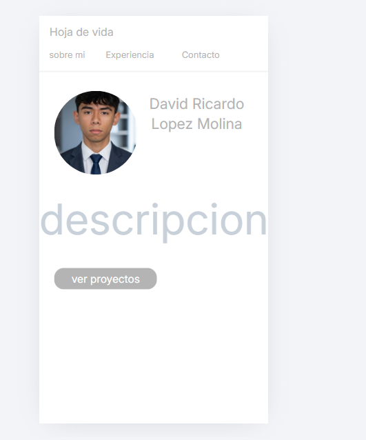
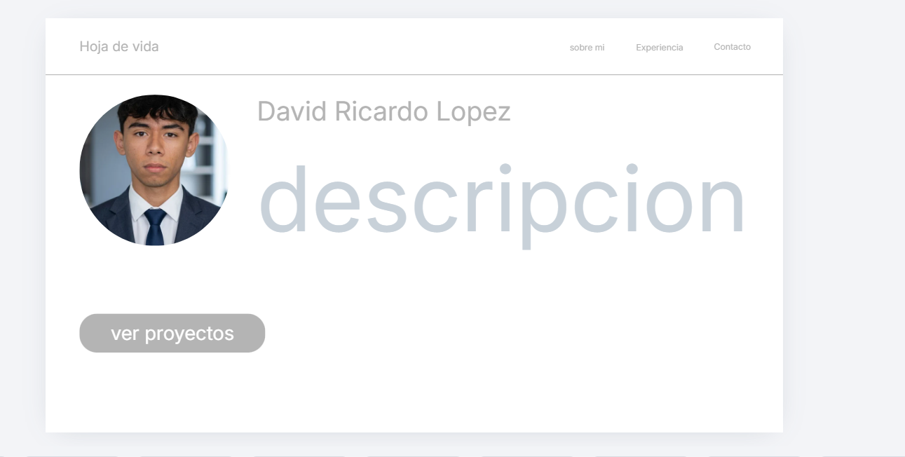
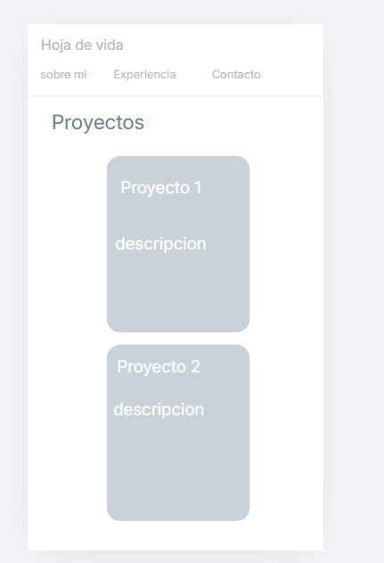
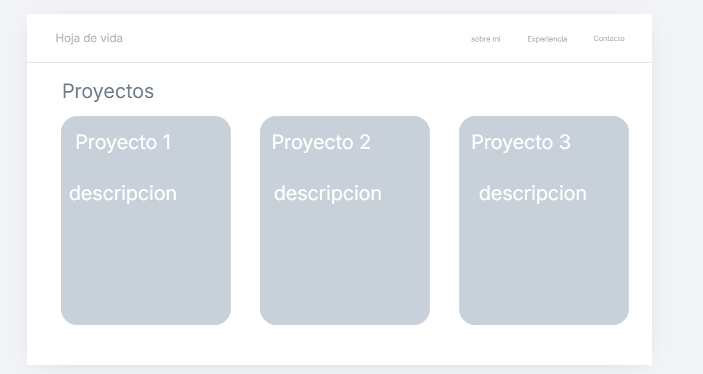
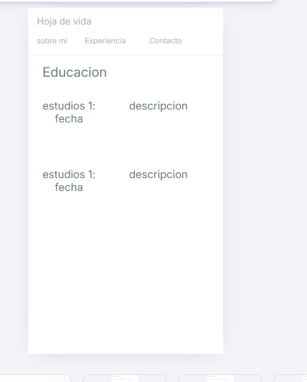
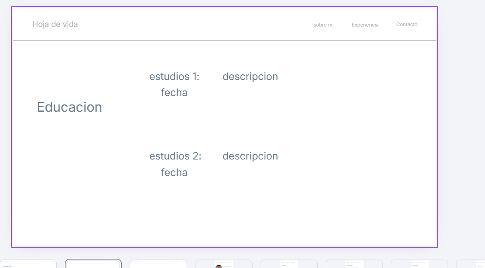

# Hoja de vida web - david lopez
Sitio personal con mi hoja de vida, mis proyectos de software y mi información de contacto.
 **Sitio publicado:** https://davi662.github.io/hoja-de-vida/
## Páginas
- index.html: 
index.html:pagina de inicio con mi informacion personal
proyectos.html: pagina con mis proyectos realisados
contacto.html:pagina con mis contactos para que me contacten (no tengo linkedin pero agrege el link para que se viera profesional)
## Mockups

### pagina principal

### Proyectos 

### Educacion 

## contacto

## sobre mi

## Breakpoints
- **Base (celular):** Todo en una columna (Mobile First).
- **Desde 600px (Tablets):** El texto de la descripción y la foto de perfil aumentan de tamaño para ajustarse a una pantalla mediana. Las tarjetas de proyectos pueden mostrar 2 columnas según el espacio.
- **Desde 1024px (Computadores):** El grid cambia usando `grid-template-areas` a dos columnas. El perfil, la educación y el contacto distribuyen su información horizontalmente (textos principales a la izquierda, detalles a la derecha).
## Cómo lo publiqué
lo publique en github siguiendo estos pasos

1. Creé un nuevo repositorio público en mi cuenta de GitHub.
2. Subí todos los archivos de mi proyecto (`.html`, `.css` y las carpetas con imágenes).
3. Entré a la pestaña de "Settings" (Configuración) de mi repositorio.
4. Fui a la sección de "Pages" en el menú lateral izquierdo.
5. En la opción de "Source" (o "Build and deployment"), seleccioné la rama "main" y guardé los cambios.
6. Esperé un par de minutos hasta que la plataforma generó mi enlace oficial publicado.
## Fuentes consultadas
- ninguna